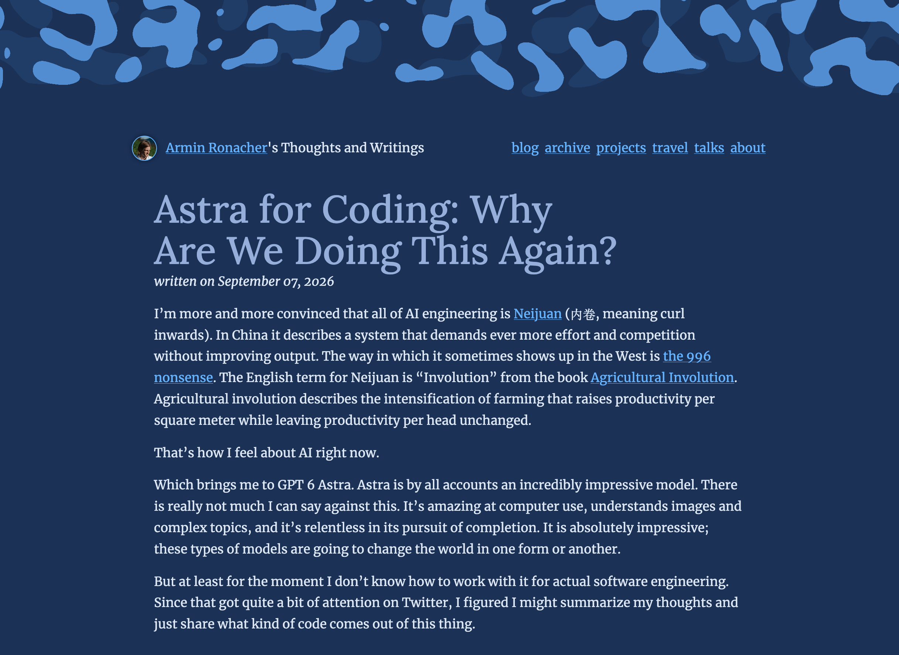

# Astra 编程：我们为何重蹈覆辙？

> 原作者：Armin Ronacher，2026 年 9 月 7 日
> 原文链接：[astra-why](https://lucumr.pocoo.org/2026/9/7/astra-why)
> 本文初稿由 AI 生成，后经人类润色。



我越来越相信，整个 AI 工程就是一场内卷。在中国，这个词指一种体系：它要求人们付出越来越多的努力、进行越来越激烈的竞争，产出却没有提高。在西方，它更多以“996”这种扯淡的体系为人们所知。“内卷”的英文是 “Involution”，出自《农业内卷化》一书。农业内卷化指的是农业不断精耕细作，每平方米的产量提高了，人均生产率却没有变化。

这正是我现在对 AI 的感受。

这也带出了我要聊的 GPT 6 Astra。人们普遍认为 Astra 是一个极其出色的模型，这一点我真的没什么可反驳的。它非常擅长 Computer Use，能理解图像和复杂话题，并且会锲而不舍地把任务做完。它确实令人印象深刻；这样的模型终将以某种形式改变世界。

但至少目前，我不知道怎么在真正的软件工程中使用它。既然这一点在 Twitter 引起了不少关注，我想我或许该把我的想法整理成文，顺便展示一下这东西到底会写出什么样的代码。

## 我的垃圾工厂

“Armin，你应该搞一个软件工厂！”这话我已经听过好几次了，所以我想，为了庆祝 Astra 发布，不如周末跑一个小型软件工厂。既然大家都在用它做粗制滥造的 3D 游戏，那我就应该拿它做点有用的事。我特意把这个软件工厂设计成让模型自己决定怎么安排工作流。它可以自由管理自己的上下文，可以在 agent-notes 文件夹里维护自己的工作记录，然后派 subagent 去干活。目标是什么？做一个带虚拟线程和词法作用域的 Python。结果我烧掉了一整个重置周期的 token——大约 40 亿个。35 小时后，这个工厂没有交付任何有价值的东西，也没有教会我怎样运营一个更好的工厂。

不过它产出了大量代码和输入提示词，我可以研究研究这些东西。它表现出的行为，是我在 Sol 及更早的 OpenAI 模型上不曾见过的[^1]。后来在用 Astra 做普通的编程时，我也遇到了同样的问题，所以这并不只是“工厂”这个模式的问题。

我怀疑训练过程中有什么地方“出了问题”。模型在长周期任务上取得成功会获得巨大奖励，但对“烂代码”的惩罚大概很少。结果显然是，Astra 做 3D 内容非常厉害，能持续工作很长时间，还能在过程中自己给自己找活干。我让它对我的扫地机器人做了不少逆向工程，表现相当惊人。所以它确实很酷！

## 代码高尔夫式的工具调用

> 译者注：“代码高尔夫”原文 Code Golf，指的是一种通过最少字数的代码来完成特定任务的游戏。这种游戏里的“最佳代码”通常会极致地压缩长度，导致可读性几乎为零。

我对 Astra 的第一个不满，来自它在工具调用中使用的那种代码。Codex 越来越依赖“直接用 bash”来完成越来越多的操作。好几个版本以来，原版 Codex（harness）都直接用 sed 等工具读取文件。你通常看不到这些命令，因为 Codex 会解析 bash 命令，识别出来后就把它们隐藏起来。但 Astra……真的很爱 Python？这倒不算太意外，因为更早的 OpenAI 模型有时也会临时写 Python 代码来读取和修改文件。但在我这里，Astra 用得实在太过头了。

这里有个重要的免责声明：这个项目本身非常“元”，因为我是在 CPython 解释器上做开发。但我可以向你保证，即使在 Pi 的 TypeScript 代码里，我也见过这个模型做一些奇怪的 Python 操作。不过最多的怪异代码证据还是来自我让它在垃圾工厂里零监督地干了一个周末的那次。

> 译者注：“元”原文 meta，指的是所指事物和自身之间存在某种关系。这里指作者的 AI“开发 CPython 时爱写 Python 代码”的行为。

它写 Python 这件事本身并不有趣，有趣的是它写的是什么样的 Python。我收集了一些输出，供你们随便扫一眼。


<details>
<summary>用 Python 字符串拼接来编辑 C 代码</summary>

在 Codex 中，我发现好几次 subagent 完全不用 patch 工具，而是用 Python 手工拼接字符串。

```sh
python3 - <<'PY'
from pathlib import Path
p=Path('Include/internal/pycore_intrinsics.h');s=p.read_text().replace('#define MAX_INTRINSIC_1                         14','#define INTRINSIC_RETAIN_ANNOTATION_CELLS        15\n\n#define MAX_INTRINSIC_1                         15');p.write_text(s)
p=Path('Python/intrinsics.c');s=p.read_text();idx=s.index('#define INTRINSIC_FUNC_ENTRY');s=s[:idx]+'''/* Hold every old cell until the compiler has published the entire site's new
   capture. A replaced cell's finalizer may reenter module __annotate__. */
static PyObject *
retain_annotation_cells(PyThreadState *tstate, PyObject *holders)
{
    if (!PyTuple_CheckExact(holders)) {
        PyErr_SetString(PyExc_TypeError, "annotation holders must be a tuple");
        return NULL;
    }
    Py_ssize_t size = PyTuple_GET_SIZE(holders);
    PyObject *previous = PyTuple_New(size);
    if (previous == NULL) return NULL;
    for (Py_ssize_t i = 0; i < size; i++) {
        PyObject *holder = PyTuple_GET_ITEM(holders, i);
        if (!PyCell_Check(holder)) {
            Py_DECREF(previous);
            PyErr_SetString(PyExc_TypeError, "annotation holder must be a cell");
            return NULL;
        }
        PyObject *cell = PyCell_Get(holder);
        PyTuple_SET_ITEM(previous, i, cell == NULL ? Py_NewRef(Py_None) : cell);
    }
    return previous;
}

''' +s[idx:];s=s.replace('    INTRINSIC_FUNC_ENTRY(INTRINSIC_AWAIT_BLOCK, await_block)','    INTRINSIC_FUNC_ENTRY(INTRINSIC_AWAIT_BLOCK, await_block)\n    INTRINSIC_FUNC_ENTRY(INTRINSIC_RETAIN_ANNOTATION_CELLS, retain_annotation_cells)');p.write_text(s)
p=Path('Python/codegen.c');s=p.read_text();idx=s.index('static int\ncodegen_annassign(');s=s[:idx]+'''static int
codegen_retain_annotation_cells(compiler *c, location loc, PyObject *captures)
{
    Py_ssize_t pos = 0;
    PyObject *binding, *holder;
    while (PyDict_Next(captures, &pos, &binding, &holder)) {
        ADDOP_NAME(c, loc, LOAD_CLOSURE, holder, cellvars);
    }
    ADDOP_I(c, loc, BUILD_TUPLE, PyDict_GET_SIZE(captures));
    ADDOP_I(c, loc, CALL_INTRINSIC_1, INTRINSIC_RETAIN_ANNOTATION_CELLS);
    return SUCCESS;
}

''' +s[idx:]
a=s.index('                if (conditional_annotation_index != NULL) {',s.index('codegen_annassign(compiler *c'))
b=s.index('                if (captures != NULL) {',a)
# Move lookup before conditional registration and retain old cells before anything changes.
lookupstart=s.index('                PyObject *captures = _PyCompile_AnnotationCaptures',a)
lookup=s[lookupstart:b].replace('                    return ERROR;','                    Py_XDECREF(conditional_annotation_index); return ERROR;')
s=s[:lookupstart]+s[b:]
setup=lookup+'''                if (captures != NULL && codegen_retain_annotation_cells(c, loc, captures) < 0) {
                    Py_XDECREF(conditional_annotation_index); return ERROR;
                }
'''
s=s[:a]+setup+s[a:]
needle='                        ADDOP_NAME(c, loc, STORE_DEREF, holder, cellvars);\n                    }\n                }'
s=s.replace(needle,'                        ADDOP_NAME(c, loc, STORE_DEREF, holder, cellvars);\n                    }\n                    ADDOP(c, loc, POP_TOP); /* release old cells after full publication */\n                }',1);p.write_text(s)
p=Path('Include/internal/pycore_magic_number.h');s=p.read_text().replace('    Python 3.16a1 3709 (Checked deferred annotation closure capture)','    Python 3.16a1 3709 (Checked deferred annotation closure capture)\n    Python 3.16a1 3710 (Retain replaced annotation captures until publication)').replace('#define PYC_MAGIC_NUMBER 3709','#define PYC_MAGIC_NUMBER 3710');p.write_text(s)
p=Path('Lib/test/test_block_annotation_captures.py');s=p.read_text();idx=s.index('    def test_typing_consumers');s=s[:idx]+'''    def test_replaced_cell_finalizer_sees_complete_site_publication(self):
        module=execute("""\\
            events=[]
            class V:
                def __init__(self,n): self.n=n
                def __del__(self):
                    if self.n == 0: events.append(__annotate__(1))
            for i in range(2):
                x=V(i) # bind x y
                y=i
                value:(x.n,y)
        """)
        self.assertEqual(module.events,[{'value':(1,1)}])
        self.assertEqual(module.__annotate__(1),{'value':(1,1)})

''' +s[idx:];p.write_text(s)
PY
make -j1 > /tmp/block-annotations-build7.log 2>&1
```

</details>


<details>
<summary>套接字代码高尔夫</summary>

会话进行到一半时，代理在测试中遇到了 “Bad file descriptor” 错误。Astra 认为需要用一种超级压缩的写法，验证一下在 macOS 上能否通过 Unix 套接字传递文件描述符。

```sh
/usr/bin/python3 - <<'PY'
import socket,os,array
for into in (False,True):
 a,b=socket.socketpair();fd=os.open(os.devnull,os.O_RDONLY);b.sendmsg([b'c'],[(socket.SOL_SOCKET,socket.SCM_RIGHTS,array.array('i',[fd]))]);print('fds',a.fileno(),b.fileno(),fd)
 if into:r=a.recvmsg_into([bytearray(1),bytearray(),bytearray(19)],socket.CMSG_SPACE(4),socket.MSG_PEEK|socket.MSG_DONTWAIT)
 else:r=a.recvmsg(20,socket.CMSG_SPACE(4),socket.MSG_PEEK|socket.MSG_DONTWAIT)
 print('peek',r,flush=True)
 rights=array.array('i',r[1][0][2]);print('rights',rights,flush=True)
 for f in rights:
  try: print('stat',os.fstat(f))
  except Exception as e: print('error',e)
 r=a.recvmsg(20,socket.CMSG_SPACE(4),socket.MSG_DONTWAIT);print('consumed',r,flush=True)
 a.close();b.close();os.close(fd)
PY
```

</details>


<details>
<summary>用 Python 修补 agent note</summary>

Agent note 几乎一直都是用 Python 更新的。

```sh
python3 - <<'PY'
from pathlib import Path
p=Path('agent-notes/live/block-with-bindings.md');s=p.read_text().replace('  has117/77/zero failures.', '  has117/77/zero failures; existing bundled Expat unreachable-fallthrough\n  warnings are the only optimized warnings.')
# Keep the final evidence readable without rewriting historical parent requirements.
for a,b in [('all328','all 328'),('pass31','pass 31'),('pass all328','pass all 328'),('pass,9.2s','pass, 9.2s'),('log`,210','log`, 210'),('log`,5,731','log`, 5,731'),('log`:18/18','log`: 18/18'),('pass,88','pass, 88'),('pass,90','pass, 90'),('skips,1m','skips, 1m'),('all6,280','all 6,280'),('has117','has 117')]: s=s.replace(a,b)
s += '\nKey source review: Python/symtable.c:603 (discovery), :3985 (sequential header traversal),\nPython/codegen.c:3488 (source-only exclusion), :5836 (publication), :5853 (normal/\nunwind reference cleanup), :5925/:6037 (enter-protected target setup).\n'
p.write_text(s)
for name in ('STATE.md','build-and-test.md'):
 p=Path('agent-notes/live')/name;s=p.read_text()
 for a,b in [('build:117','build: 117'),('paths.18','paths. 18'),('paths.\n18','paths.\n18'),('and210','and 210'),('pass5,731','pass 5,731'),('All6,280','All 6,280'),('failures,31','failures, 31'),('in\n115s','in\n115s'),('have117','have 117'),('paths.\n18','paths.\n18'),('18 focused,210','18 focused, 210'),('and5,731','and 5,731'),('all6,280','all 6,280')]: s=s.replace(a,b)
 p.write_text(s)
PY
git diff --check
git add -u
git add Lib/test/test_block_with_bindings.py agent-notes/done/asyncio-task-drivers.md
git diff --cached --stat
git commit -m 'Add explicit with and async with header bindings'
```

</details>


<details>
<summary>用 Python 运行 Node.js</summary>

有好几次，它用 Python 在另一台机器上启动 Node.js：先写好脚本，再用 Bash 运行 Python，然后由这个 Python 程序通过 prlctl 在我的 Windows 机器上运行 Node.js。

```py
import subprocess
code = "const{readFileSync}=require('fs');const{strict:a}=require('assert');const c=require('C:/Users/mitsuhiko/AppData/Local/Temp/pi-clipboard-threads/win32-arm64.node');(async()=>{const p=c.getText();a.ok(p instanceof Promise);const saved=await p;const image=await c.getImage();if(image||saved===null){console.log('arm64 async text/image reads passed; preserving non-text clipboard');return}try{for(const text of ['café 日本語','', 'large'.repeat(200000)]){const p=c.setText(text);a.ok(p instanceof Promise);await p;a.equal(await c.getText(),text);a.equal(await c.getImage(),null)}console.log('Windows ARM64 async Unicode, empty, large text and empty image passed')}finally{await c.setText(saved)}})().catch(e=>{console.error(e);process.exitCode=1})"
subprocess.run(['prlctl', 'exec', 'Windows 11', '--current-user', 'C:\\Program Files\\nodejs\\node.exe', '-e', code], check=True)
```

</details>


<details>
<summary>用 Python 运行 Node.js 再运行 PowerShell</summary>

既然已经这么干了，它干脆用 Bash 运行 Python，用 Python 运行 Node.js，再用 Node.js 调用 PowerShell。

```py
import subprocess
code = "process.env.PSModulePath='C:/Windows/System32/WindowsPowerShell/v1.0/Modules';require('child_process').spawnSync('powershell.exe',['-NoProfile','-NonInteractive','-ExecutionPolicy','Bypass','-File','C:/Users/mitsuhiko/AppData/Local/Temp/pi-clipboard-threads/pi-clipboard-windows.ps1'],{stdio:'inherit'});console.log('completed')"
subprocess.run(['prlctl', 'exec', 'Windows 11', '--current-user', 'C:\\Program Files\\nodejs\\node.exe', '-e', code], check=True)
```

</details>


你可能觉得这挺好笑，但我对此有些疑问。第一个问题是，人类根本读不懂。如果你想搞清楚正在发生的事情，祝你好运。尤其是当它放弃使用 harness 提供的编辑工具时，你只能去看最终产物的 diff，因为光读这些代码，几乎不可能看出改动在实时发生什么。

在 Pi 里情况基本没这么糟，因为我看到的多数编辑行为都是通过 edit 工具完成的。但一旦它带着 subagent 彻底放飞（在 agent 以为没人看着的地方），就会出现各种越来越离奇的行为。我其实不知道模型是否认为有人在看，但这就是我的感觉。

然后，它开始在真正会被提交的代码里干同样的蠢事。我主要在测试里看到这种情况。不过你也能在别处看到，比如它写嵌在 HTML 里的 JavaScript 或 CSS 时。看起来，一旦离常规代码“隔了一层”，它就会陷入这些模式。

下面是它写的一些单元测试：


<details>
<summary>完全无视空白和缩进</summary>

```py
def test_unpack_suspension_and_continuation_close(self):
    from continuations import Continuation,suspend
    readers=[]
    class Source:
        def __iter__(self):
            yield 1
            suspend('unpacking')
            yield 2
    ns=execute('''
        def run():
            a,b='old-a','old-b'
            readers.append(lambda: (a,b))
            def a,b=Source()
            suspend('published')
    ''',Source=Source,readers=readers,suspend=suspend)
    with Continuation(ns['run']) as continuation:
        self.assertEqual(continuation.resume(),'unpacking')
        self.assertEqual(readers[0](),('old-a','old-b'))
        self.assertEqual(continuation.resume(),'published')
        self.assertEqual(readers[0](),(1,2))
    class Value:pass
    refs=[];frames=[];callbacks=[]
    ns=execute('''
        def run():
            for def x in [Value()]:
                refs.append(weakref.ref(x))
                frames.append(sys._getframe())
                callbacks.append(lambda: x)
                suspend('body')
    ''',Value=Value,refs=refs,frames=frames,callbacks=callbacks,weakref=weakref,sys=sys,suspend=suspend)
    with Continuation(ns['run']) as continuation:self.assertEqual(continuation.resume(),'body')
    self.assertNotIn('x',frames[0].f_locals)
    self.assertIsNotNone(refs[0]());callbacks.clear();self.assertIsNone(refs[0]())

def test_ast_roundtrips_and_future_annotation_unparse(self):
    source='callback=lambda {for def a, [b,*rest] in [(1,[2,3])] {return a,b,rest}}'
    tree=ast.parse(source);node=tree.body[0].value.body[0]
    self.assertIsInstance(node,ast.ForBinding)
    self.assertEqual(node._fields,('target','iter','body','orelse','type_comment'))
    self.assertEqual(node.lineno,1);self.assertGreater(node.end_col_offset,node.col_offset)
    self.assertEqual(ast.dump(tree),ast.dump(ast.parse(ast.unparse(tree))))
    ns=execute('from __future__ import annotations\ndef f(arg: '+source.split('=',1)[1]+'): pass')
    self.assertEqual(eval(ns['f'].__annotations__['arg'])(),(1,2,[3]))
    tree=ast.parse('async def f():\n async for def x in values: pass # type: ignored\n')
    self.assertIsInstance(tree.body[0].body[0],ast.AsyncForBinding)
    self.assertEqual(ast.dump(tree),ast.dump(ast.parse(ast.unparse(tree))))
```

</details>


所以至少在某些情况下，它为了让工具调用更省 token 而写的代码高尔夫式 Python 垃圾，会渗进本应长期保存的 Python 代码里。而且这种写法确实更省 token：上面两个单元测试按所在类的结构缩进后，这种写法比经过 ruff format 格式化后的版本省 10% 的 token。

## 只要你不看细节，它就是 AGI

我觉得现在有几件事正同时发生，它们把整件事推向了相互冲突的方向。这些模型的训练正在迅速加速，现在大概也在朝递归自我改进的方向发展。模型的奖励可能综合了 token 效率、任务完成率，也许还有圈复杂度之类的简单指标。但我们人类不会用简单、易于量化的指标来衡量代码是否可读、可理解。所有这些指标都很容易单独测量，也很容易在局部做优化。

但局部优化并不会带来全局最优，而看输出的人越少，这一点就越无关紧要。我的软件工厂在运行的大约 35 小时里显然搁浅了，你能从它写下的笔记里看出它是如何逐渐滑向疯狂的。比如，任务文件里的任务编号一开始还很乐观，是 1、2、3、5、5a，后来变成 8a、8a1，最后变成了 8b2c2b3 和 “8b2c2b2b checkpoint1”。它写的代码也越来越离谱。我不想拿它试图构建的东西烦你，但下面是一些解释器改动的例子：


<details>
<summary>到处都是硬编码常量</summary>

我完全不知道这些数字是从哪来的。某个时候，它开始把随机常量从一个模块传给一个 C 实现。起初那只是一个主要用于测试断言的函数，但就在我关停这个实验前不久，非测试代码也开始依赖这个函数了。

```c
static PyObject *
native_probe_run_impl(PyObject *callback, int sleep, int operation, PyObject *other)
{
    pthread_mutexattr_t attr;
    pthread_mutex_t mutex;
    pthread_mutexattr_init(&attr);
    pthread_mutexattr_settype(&attr, PTHREAD_MUTEX_RECURSIVE);
    pthread_mutex_init(&mutex, &attr);
    pthread_mutexattr_destroy(&attr);
    pthread_mutex_lock(&mutex);
    int previous = native_sentinel;
    pthread_mutex_t *previous_mutex = native_mutex;
    native_sentinel = previous + 1;
    native_mutex = &mutex;
    PyThreadState *tstate = PyThreadState_Get();
    PyGILState_STATE gil = PyGILState_Ensure();
    int saved_errno = errno;
    PyObject *result = NULL;
    Py_ssize_t value;
    /* No intervening Python frame: these exercise ambient C provenance. */
    switch (operation) {
        case 0: result = PyObject_CallNoArgs(callback); break;
        case 1: result = PyNumber_Add(callback, other); break;
        case 2: result = PyNumber_Negative(callback); break;
        case 3: result = PyObject_RichCompare(callback, other, Py_LT); break;
        case 4:
            value = PyObject_IsTrue(callback);
            if (value >= 0) result = PyBool_FromLong(value);
            break;
        case 5:
            value = PyObject_Length(callback);
            if (value >= 0) result = PyLong_FromSsize_t(value);
            break;
        case 6: result = PyObject_GetIter(callback); break;
        case 7: result = PyIter_Next(callback); break;
        case 8: result = PyObject_GetItem(callback, other); break;
        /* ... */
        case 21:
            result = PyType_Type.tp_call(callback, other, NULL);
            break;
        case 22: case 23: case 24: case 25: case 26:
            result = conversion_probe(operation, callback); break;
        case 27: case 28: case 29:
            result = protocol_probe(operation, callback, other); break;
        case 30: case 31: case 32: case 33: case 34: case 35:
        case 36: case 37: case 38: case 39: case 40: case 41:
        case 42: case 43: case 44: case 45: case 46:
        case 47: case 48: case 49: case 50: case 51: case 52:
        case 53: case 54: case 55: case 56: case 57: case 58: case 59:
        case 60: case 61: case 62: case 63: case 64: case 65: case 66:
        case 67: case 68: case 69: case 70: case 71: case 72:
            result = collection_probe(operation, callback, other); break;
        default: PyErr_SetString(PyExc_ValueError, "bad probe operation");
    }
```

</details>


<details>
<summary>C 代码里同一行调用多个宏</summary>

CPython 代码库里根本没有这种代码风格，但它却出现在新生成的代码里。

```c
PyObject *info = PyTuple_Pack(3, name, mangled, suite->su_id);
PyObject *flags = PyLong_FromLong(DEF_LOCAL);
if (key == NULL || info == NULL || flags == NULL ||
    PyDict_SetItem(suite->su_bindings, mangled, key) < 0 ||
    PyDict_SetItem(st->st_cur->ste_block_bindings, key, info) < 0 ||
    (private && PyDict_SetItem(st->st_binding_info, key, info) < 0) ||
    (private && PyDict_SetItem(st->st_cur->ste_symbols, key, flags) < 0)) {
    Py_DECREF(mangled); Py_XDECREF(key); Py_XDECREF(info); Py_XDECREF(flags);
    goto error;
}
Py_DECREF(mangled); Py_DECREF(key); Py_DECREF(info); Py_DECREF(flags);
```

</details>


<details>
<summary>生产代码里的随机索引</summary>

和运算符编号一样，它还用列表里的随机整数索引来存放状态。

```py
def _register_task(task):
    """Register an asyncio Task scheduled to run on an event loop."""
    _scheduled_tasks.add(task)
    if _task_accelerator is not None:
        _task_accelerator[6](task)


def _register_eager_task(task):
    """Register an asyncio Task about to be eagerly executed."""
    _eager_tasks.add(task)
    if _task_accelerator is not None:
        _task_accelerator[8](task)


def _enter_task(loop, task):
    if (_task_accelerator is not None and
            _task_accelerator[5]() is loop and loop not in _current_tasks):
        return _task_accelerator[1](loop, task)
    # ...
```

</details>


<details>
<summary>丑陋的 C 分词器代码</summary>

这不是这个代码库的风格，坦白说，它不应该是任何人的风格。我不明白模型为什么要这么写。

```c
static int
apply_layout(tokenizeriterobject *it)
{
    PyObject *source = PyBytes_FromStringAndSize(it->tok->source.bytes, it->tok->source.len);
    if (source == NULL) return -1;
    PyObject *events = _PyPegen_tokenize_layout(PyBytes_AS_STRING(source), it->tok->filename);
    Py_DECREF(source);
    if (events == NULL) return -1;
    PyObject *result = PyList_New(0);
    if (result == NULL) { Py_DECREF(events); return -1; }
    Py_ssize_t index = 0;
    PyObject *first_pos = PyTuple_GET_ITEM(PyList_GET_ITEM(it->pending, 0), 2);
    PyObject *last_pos = PyTuple_GET_ITEM(PyList_GET_ITEM(it->pending, PyList_GET_SIZE(it->pending)-1), 2);
    PyObject *previous = NULL;
    for (Py_ssize_t i = 0; i < PyList_GET_SIZE(events); i++) {
        PyObject *event = PyList_GET_ITEM(events, i);
        if (previous && PyObject_RichCompareBool(previous, event, Py_EQ) == 1) continue;
        previous = event;
        PyObject *token = layout_token(it, event);
        if (token == NULL) goto error;
        if (token == Py_None) { Py_DECREF(token); continue; }
        PyObject *pos = PyTuple_GET_ITEM(token, 2);
        if (PyObject_RichCompareBool(pos, first_pos, Py_LE) == 1 ||
            PyObject_RichCompareBool(pos, last_pos, Py_GT) == 1) { Py_DECREF(token); continue; }
        while (index < PyList_GET_SIZE(it->pending)) {
            PyObject *old = PyList_GET_ITEM(it->pending, index);
            int cmp = PyObject_RichCompareBool(PyTuple_GET_ITEM(old, 2), pos, Py_LT);
            if (cmp < 0) { Py_DECREF(token); goto error; }
            if (!cmp) break;
            if (PyList_Append(result, old) < 0) { Py_DECREF(token); goto error; }
            index++;
        }
        if (index < PyList_GET_SIZE(it->pending)) {
            PyObject *old = PyList_GET_ITEM(it->pending, index);
            long kind = PyLong_AsLong(PyTuple_GET_ITEM(old, 0));
            if ((kind == NL || kind == NEWLINE || kind == INDENT || kind == DEDENT) &&
                PyObject_RichCompareBool(PyTuple_GET_ITEM(old, 2), pos, Py_EQ) == 1) index++;
        }
        if (PyList_Append(result, token) < 0) { Py_DECREF(token); goto error; }
        Py_DECREF(token);
    }
    for (; index < PyList_GET_SIZE(it->pending); index++) {
        if (PyList_Append(result, PyList_GET_ITEM(it->pending, index)) < 0) goto error;
    }
    Py_SETREF(it->pending, result);
    Py_DECREF(events);
    return 0;
error:
    Py_DECREF(events);
    Py_DECREF(result);
    return -1;
}
```

</details>


失败的原因似乎相当明显：人们以工具调用的 token 效率为指标训练模型，而工具调用本身看起来也像代码。有时它会把那种代码带到不该去的地方，也就是代码库里。

## 一个提示词跑了 35 小时

我真不知道该怎么评价，但这台垃圾机器一直跑了 35 小时，直到我把它关掉。在这段时间里，它净增了 7.5 万行代码，而且根本没有停下来的意思。35 小时里，它烧掉了大约 10 亿 token，按原始 API 价格计算，总成本约 1200 美元。它做了了 79 次 commit，相当于每次 commit 约 15.5 美元，代理之间交换了约 1400 条消息。

老实说，我不需要一个代理对着一个提示词跑 35 小时。这显然行不通，也产出不了合理的结果。

所以很显然，这样给它下提示词是愚蠢的。但如果无人看管，它就是会一直跑下去，而更早的模型不会这样。连 Fable 都没这么疯狂。如果你不小心给了它一个稍微大了一点的任务，它会一直干到成功为止，哪怕烧光整个订阅额度。

这差不多就是我目前不太信任这个模型的原因。它已经表明自己会提交垃圾代码，所以我必须更仔细地审查它的产出。即使失败率很低，我也不想要这种东西。

## 一次性代码与提交的代码

在一个为 token 效率和“把活干完”而优化工具调用代码的世界里，我怀疑训练过程中是否真的有足够的信号来体现“人类能看懂发生了什么”。我得说，我从 Astra 那里得到的代码，有相当一部分在我看来是“客观上很糟糕”的。但这是按我作为人类的标准来说的。对于一个完全由代理编写、只需要代理能看懂的代码库来说，也许它反而客观上很好。

这就是为什么我越来越认真地问自己：我们到底为什么要这样做？这些新模型无疑非常惊人。但我越来越怀疑，它们当前的发展轨迹是否仍然适合当今的软件工程流程。我之所以问“为什么要这样做”，是因为我觉得我们已经在软件工程上用这些模型达到了一个相当不错的状态，而这恰恰是 AI 经济中能够证明有正回报的那部分。但考虑到 Fable 贵了那么多、Astra 也贵了那么多，我并不觉得结果配得上这个价格。

事实上，对于 Astra 和 Fable，我觉得不仅成本高得离谱，而且这些模型根本就不是为我这样的软件工程师准备的。大概是因为这些模型越来越多地服务于其他人：律师、3D 艺术家、数学家、所有那些会用 Computer Use 的人，等等。

而作为实现这一切的副产品，你现在可以在一个周末里靠粗制滥造一次性生成一个看起来很惊艳的 3D 游戏。只要你不在乎代码，大概你现在也能一直运营一个你的软件工厂。

我相信我会慢慢习惯，但天哪，这东西真是太怪了。

**P.S：**说到怪，这些模型身处沙箱，按理说没有任何办法和其他代理通信，它们是怎么找到同一批公共 wiki、把它们当作代理之间通信的草稿板的？它们是不是在训练过程中串通好，记住了互联网上将来可能派上用场的资源？

> 译者注：这篇文章指出，模型只能写出“能跑”的代码，却写不出好的代码。这大概也是为什么很多人（包括我）不信任甚至看不起那些完全是 Vibe Coding 出来的项目。

[^1]: 我应该说明，我以前也做过类似的实验。通常它们不会运行这么久。Agent 最后做出来的软件或许不完美，但至少能看懂、能消化。
