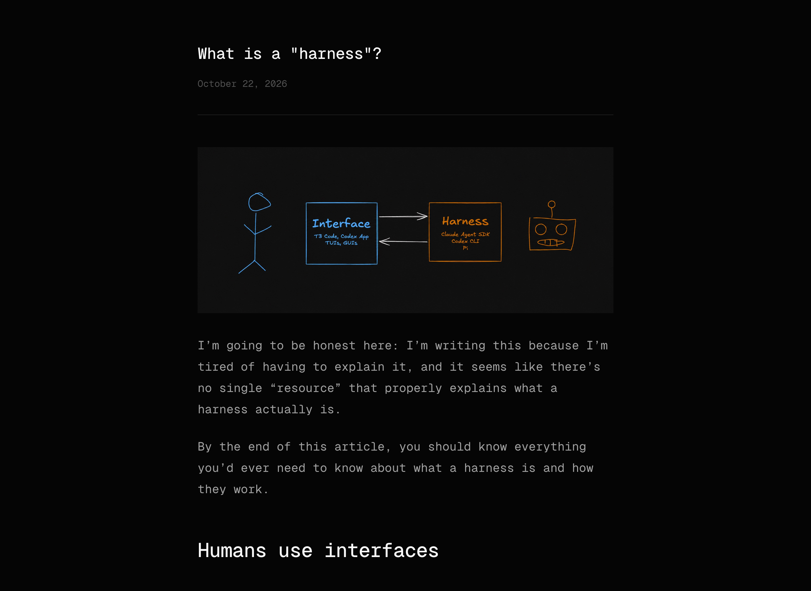
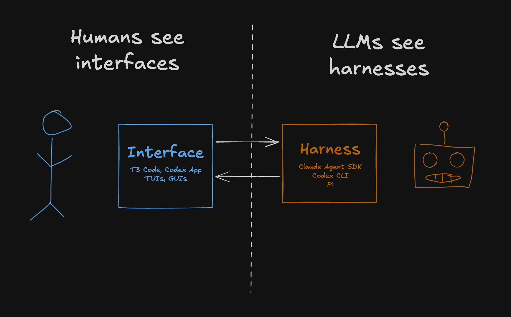
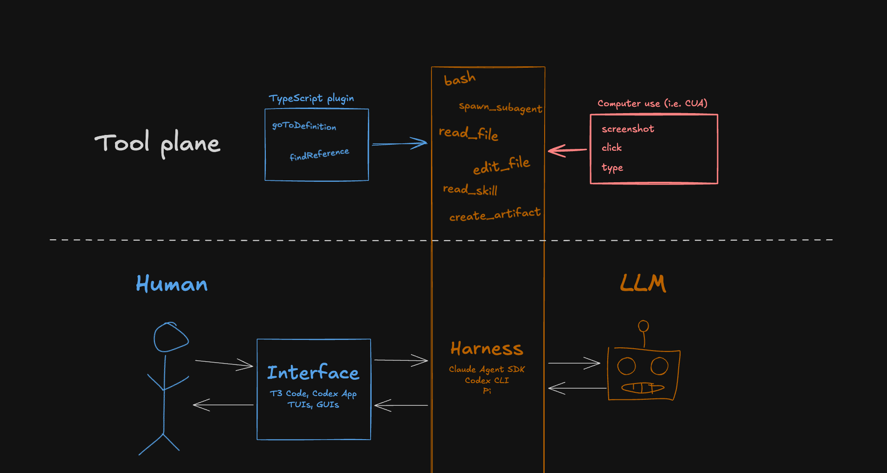
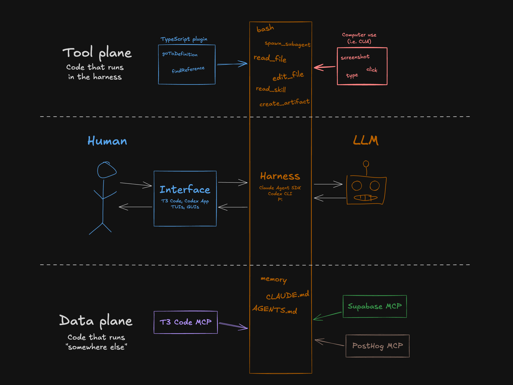
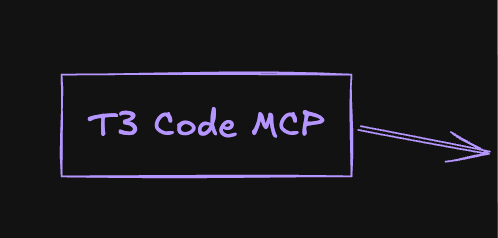

# 什么是“harness”

> 原作者：Theo，2026 年 10 月 22 日
>
> 原文链接：[what-is-a-harness](https://t3.gg/blog/post/what-is-a-harness)
>
> 本文由人类翻译而成，部分内容参考了 AI 翻译。



说实话，我写这篇文章只是因为我懒得再给人解释什么是“harness”，但又没有一份现成的“资料”能讲清楚它到底是什么。

看完这篇文章，你就会知道你需要知道的所有关于“harness”是什么和它如何工作的事情。

## 人类用的是交互界面

一般来说，人类不是靠写代码来使用电脑的。他们靠的是某种交互界面：终端，网页，或者软件。

理论上，对于一个人类要做的每一件事，他都可以写一份 Python 或 JS 代码来完成。但我们并没有让他们这样做，而是用按钮、快捷键、命令等方式让他们能调用这些代码。

一些交互界面的例子：Chrome 浏览器，Claude Code，ChatGPT 桌面端（前身为 Codex）。

值得一提的是，人类不会看到底层的代码……通常来说。人类看到的只有交互界面。

## 大语言模型（LLM）用的是 harness

默认情况下，LLM 只会生成文字。要让它做更多的事情，我们得给它工具。大部分 LLM 现在被训练得会使用像“read_file”（用来读你电脑上的文件），“edit_file”（用来编辑这些文件），“bash”（用来跑命令），和“search”（用来上网查信息）这样的工具。

但是 LLM 仍然只是发送文字！它不能像人类一样点击按钮。因此，我们需要一种给 LLM 用的自定义文本格式，用来表示“你应该运行一些代码”。假设我们给 LLM 规定一种调用工具的格式，比如：

```xml
<read_file name="README.md">
```

现在 LLM 知道了它可以用这种格式回复。但是这种回复仍然只是文字，它什么都不会执行！就像在电脑关机的时候在键盘上打字或者挪动鼠标一样。

得有什么东西来理解这些回复，然后基于回复的内容运行正确的代码。

为了让一个 LLM 真正能做事，它需要：

- 能做事的工具（read_file，edit_file，bash，search 等等）
- 一种能用文字调用这些工具的特殊语法
- 一个能解析 LLM 的消息，识别这种语法并运行对应代码的系统
- 一种能把工具输出回复给 LLM 的方法
- 一个带描述的工具列表告诉 LLM 怎么用工具

这就是 harness。

## “Claude Code 不就是 harness 吗？”

算是。

Claude Code 有两部分：**交互界面**和 **harness**

当你在终端里运行“claude”，打开的是 Claude 的 TUI。当你在 Claude 桌面端里打开“code”标签页，打开的是 Claude Code GUI。这些都不是 harness。

在底层，Claude Code 通过 Anthropic Agent SDK 与 agent 交互。ChatGPT 也是如此，只不过用的是 ChatGPT/Codex 里的 Codex App Server（内置于 CLI 中）。



我理解为什么人们会搞混：**Claude Code 和 Codex 都把 harness 集成到了它们的软件里。**

你也可以把 harness 集成到其他的软件里！一些这样做的例子：

- Grok Bot 用了 Cursor 的 harness
- T3 Code（文章作者的软件）用了 Anthropic Agents SDK 和 Codex App Server
- OpenClaw 用了 Pi

harness 是单独的一部分，几乎从不暴露在使用软件的人类眼前。

## 谁拥有这些工具？

我们可以把 harness 比作厨房。

厨房里有很多不同的工具。锅碗瓢盆，刀叉刨剪，等等。

没有厨房能拥有所有厨师需要的所有工具。

好的 harness 就是基于这个假设构建的，让用户自己带来他们需要的工具。

有一点要澄清：**harness 会提供大部分重要的工具。**Codex 和 Claude Code 都自带很多工具，也有像 Pi 这样的简单得多的 harness。

事情到这里变得有点复杂了，让我再画一张图解释：



橙色的框里是“包含在 Claude Code 里的东西”（准确叫法是 Agents SDK）。

你可以加入很多自定义工具，比如一个 TypeScript 插件来给你的 LLM 提供检查你代码的工具，或者一个 CUA 插件来让 agent 控制你的电脑（Computer Use）。

注意“tool plane”和“人类/LLM”层之间的这条分割线。人类和 LLM 都既看不见也摸不着这些工具。我们没有办法知道它们是否存在。把它们暴露出来的是 harness，既暴露给 LLM，也暴露给交互界面（也就是我们看到的）。

> 译者注：“我们没有办法知道它们是否存在”这句是作者的夸张说法，指的是所有的工具都在 harness 内部运作，人和 LLM 都只能接触到 harness 暴露出来的各种接口。

## MCP 让事情有点更复杂了

MCP（模型上下文协议）是一个让 harness 能更方便地利用外部工具的标准协议。简单说：工具是“在这里跑点代码来做事”，MCP 是“给别的哪里发一个 API 请求来做事”。

工具直接提供代码。MCP 使得代码可以在别的地方运行，同时 LLM 仍然可以借助 MCP 用这些代码做事。

MCP 最普遍的用处是把一些数据暴露给你的 LLM 们。想要 GPT 帮你翻邮件？MCP。想要 Claude 帮你看你网站的统计信息？MCP。

Chrome 扩展插件有点像工具。它们可以通过跑你的电脑上的 Chrome 里的代码来改变网页的运作。

MCP 更像网页。你什么都不用安装，只需要知道 URL（网址）。一旦你有了 URL，你就能得到所有你需要的信息。

把之前的东西全都汇总到一块，看起来大概像这样：



……等等，T3 Code 在这里干什么？且容我解释。



T3 Code 把一些功能暴露给了 LLM 来做一些普通 harness 做不到的事。比如，我们允许 Claude Code 线程创建 Codex 的 subagent。也有其他的工具能做到这一点，例如 Herdr，Orca 和 Superset。

那为什么还要把它暴露成 MCP？这难道只是为了省得自己做 harness 而耍的某种小伎俩吗？

引用前面的内容：

> 工具直接提供代码。MCP 使得代码可以在别的地方运行，同时 LLM 仍然可以借助 MCP 用这些代码做事。

T3 Code 包含大量用于实现各种像多 harness 的 subagent 这样酷炫功能的代码。从技术上讲，我们完全可以把 T3 Code 里所有最酷的功能拆解重构，做成一套适配 Claude Code、Codex、Antigravity、Pi、Cursor、Muse 等 agent 的插件……

但我们也可以选择把所有代码都留在 T3 Code 内部，只对外提供一个简单的 MCP 服务器，直接供 LLM 调用 :)

回到刚才厨房的比喻，MCP 就像是“菜谱”。它们只是教人做某件事的方法，但并不是这件事本身。

T3 Code 做的事情，就是给厨房提供了一本菜谱。它完全不会改变厨房原有的运作方式。如果厨师们决定翻看我们的食谱，那太棒了！他们也可以完全无视它，不会有任何影响。

## ……那什么是 agent？

你知道我一路写到这里、硬是忍住没有在没下定义之前就满嘴跑“agent”这个词，我有多为自己感到骄傲吗？这真的太不容易了，哈哈。

长话短说（tl;dr）——当你把“运行框架（harness）”和“大语言模型（LLM）”结合在一起时，产生的就是智能体（agent）。

LLM 只会生成文本，它们自己什么都干不了；harness 不过是一间间厨房，它们自己做不出任何菜。只有当 LLM 和运行框架强强联合，才能诞生一个“agent”。

市面上五花八门的“agent”，本质上往往只是不同的 harness 配置而已，比如搭配了不同的自定义工具、系统指令、MCP 服务器等等。

## T3 Code 是 harness 吗？

不是。如果你不自备一个 harness，T3 Code 是跑不起来的。

再回到刚才厨房的比喻：

- 厨师 = LLM
- 厨房 = harness
- T3 Code = 餐厅

T3 Code 就像一家允许你使用任何心仪厨房的餐厅。我们有自己偏爱的独门食谱，也会把这本食谱提供给每一间厨房——但除非你发话，否则厨师是不会主动翻开它的 :)

## 对于想进一步深入探究的朋友……

如果你喜欢这种从底层到顶层抽丝剥茧式的讲解，赶紧让你老板报销我下周即将在 [Mega.dev](https://soydev.link/mega) 上线的课程吧！我在那门课里会把这些内容剖析得更加透彻 :)

另外也别忘了去看看 [T3 Code](https://t3.codes)。它是[开源](https://github.com/pingdotgg/t3code)的，所以你可以直接让你的 agent 帮你解读它的工作原理，从而挖得更深。

最初[发布于 X](https://x.com/theo/status/2113424203345265053)。
